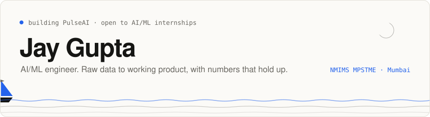
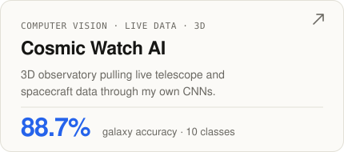
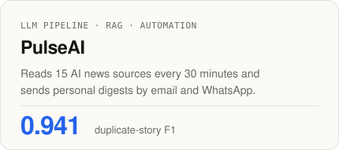
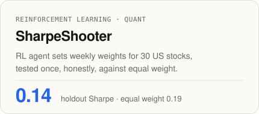

<picture>
  <source media="(prefers-color-scheme: dark)" srcset="assets/banner-dark.svg">
  
</picture>

 

I build applied AI systems end to end: data, model, API and the interface someone actually uses. Every project ships with held-out results, not just a notebook.

[Portfolio ↗](https://jaygupta.vercel.app) &nbsp;·&nbsp; B.Tech + MBA Tech (AI), NMIMS MPSTME &nbsp;·&nbsp; Ex-intern, Restaverse

 

### Selected work

  <a href="https://github.com/jay4linkh/smartcross-recommenderv2"><picture><source media="(prefers-color-scheme: dark)" srcset="assets/smartcross-dark.svg"></picture></a>
  <a href="https://github.com/jay4linkh/cosmic-watch-ai"><picture><source media="(prefers-color-scheme: dark)" srcset="assets/cosmic-dark.svg"></picture></a>

  <picture><source media="(prefers-color-scheme: dark)" srcset="assets/pulse-dark.svg"></picture>
  <picture><source media="(prefers-color-scheme: dark)" srcset="assets/sharpe-dark.svg"></picture>

Also: [RetinaGrade](https://github.com/jay4linkh/retinagrade-dr-grading), diabetic retinopathy severity grading with a ConvNeXt + ResNet hybrid.

 

### Stack

 

### Activity

  <picture>
    <source media="(prefers-color-scheme: dark)" srcset="https://github-readme-stats-dusky-five-28.vercel.app/api?username=jay4linkh&show_icons=true&include_all_commits=true&hide=contribs&hide_border=true&hide_rank=true&hide_title=true&card_width=430&bg_color=141413&text_color=F0EEE6&icon_color=4ADE80&border_radius=14">
    
  </picture>
  <picture>
    <source media="(prefers-color-scheme: dark)" srcset="https://github-readme-stats-dusky-five-28.vercel.app/api/top-langs/?username=jay4linkh&layout=compact&hide_border=true&hide_title=true&langs_count=6&card_width=430&bg_color=141413&text_color=F0EEE6&border_radius=14">
    
  </picture>

<picture>
  <source media="(prefers-color-scheme: dark)" srcset="https://github-readme-activity-graph-lyart-five.vercel.app/graph?username=jay4linkh&bg_color=141413&color=A19E95&title_color=F0EEE6&line=4ADE80&point=F0EEE6&area=true&area_color=4ADE80&hide_border=true&radius=14&custom_title=Contributions%20%C2%B7%20last%2031%20days&height=300">
  
</picture>
